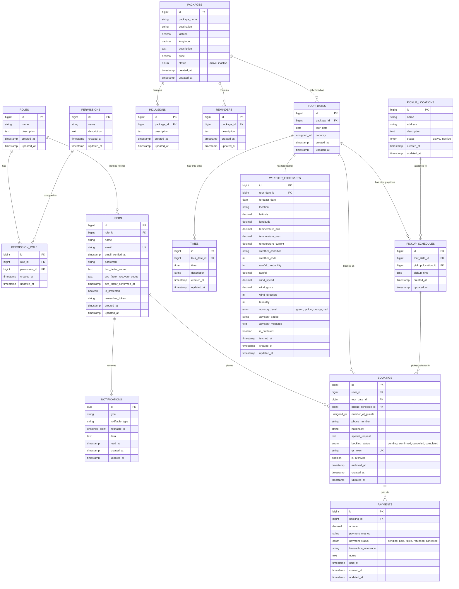

# Island Hopping & Tour Reservation System — Database ERD

This document details the Entity Relationship Diagram (ERD) and relational schema for the **Island Hopping Reservation System**.

> [!TIP]
> The visual diagram file is saved in Draw.io format at:
> - [`erd.drawio`](file:///d:/www/island-hopping-reservation-system/erd.drawio) (Project Root)
> - [`docs/erd.drawio`](file:///d:/www/island-hopping-reservation-system/docs/erd.drawio)
> 
> You can open either file in [draw.io / diagrams.net](https://app.diagrams.net/) or in VS Code with the Draw.io Integration extension.

---

## 1. Mermaid Entity-Relationship Diagram

---

## 2. Table Schemas & Relational Matrix

### A. Access Control & Users
1. **`roles`**: System roles (`Superadmin`, `Admin`, `User`).
2. **`permissions`**: Granular system permissions.
3. **`permission_role`**: Many-to-Many pivot mapping between roles and permissions.
4. **`users`**: Customer, operator, and administrator accounts.

### B. Tour Catalog
5. **`packages`**: Island hopping tour packages (price, description, GPS coordinates, status).
6. **`inclusions`**: Itemized tour inclusions per package.
7. **`reminders`**: Safety and preparation guidelines per package.

### C. Schedule, Logistics & Weather Intelligence
8. **`tour_dates`**: Specific dates when packages operate with maximum guest capacity.
9. **`times`**: Daily departure and activity times for scheduled tour dates.
10. **`weather_forecasts`**: Daily real-time Open-Meteo marine/weather forecasts and advisory risk ratings (`green`, `yellow`, `orange`, `red`).
11. **`pickup_locations`**: Master list of tourist pickup points/ports.
12. **`pickup_schedules`**: Tour-date specific pickup times assigned to pickup locations.

### D. Reservations, Payments & Archives
13. **`bookings`**: Tourist reservations with party size, contact info, status (`pending`, `confirmed`, `cancelled`, `completed`), digital QR pass token, and archival fields (`is_archived`, `archived_at`).
14. **`payments`**: Transaction records, payment methods, proofs of payment, and status (`pending`, `paid`, `cancelled`, etc.).
15. **`notifications`**: System notifications for reservations, confirmations, weather alerts, and cancellations.

